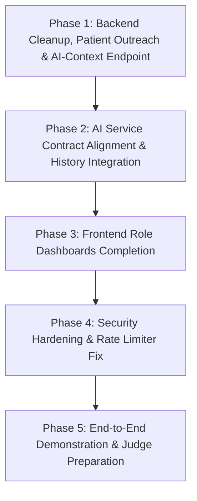

# DEVELOPMENT ROADMAP — DRISHTI (SIH26038)
*Corrected Implementation Blueprint: Zero Screening Duplication*

## 1. Updated Architectural Strategy
1. **Preserve Working Code:** Keep existing authentication controllers, password hashing, and Admin verification untouched.
2. **Zero Screening Duplication:** The MERN backend will **not** build duplicate screening tables in MongoDB. The AI developer owns the screening database and history retrieval.
3. **Backend Delivers Patient Management & AI-Context:** The MERN backend focuses on patient profiles, field outreach registration, staff verification, and the minimal patient AI-context handoff endpoint.
4. **Secure Frontend-to-AI Integration:** Frontend communicates directly with the AI service for screening submission, quality checks, XAI display, and history retrieval, secured by verified identity tokens.

---

## 2. Updated Phase Breakdown

---

### Phase 1: Backend Cleanup, Patient Outreach & AI-Context Endpoint (P0 — Critical)
- **Role:** Backend Lead
- **Tasks:**
  1. Consolidate duplicate `patient.model.js` onto `models/patientProfile.model.js`; remove redundant file.
  2. Mark `screening.model.js`, `aiResult.model.js`, `fundusImage.model.js`, and `xAiResult.model.js` as deprecated / retired so the main backend does not attempt duplicate storage.
  3. Implement **Patient AI-Context Endpoint** (`GET /api/v1/patients/:patientId/ai-context`):
     - Validates service-to-service key or authorized staff session.
     - Returns `{ patientUid, age, gender, diabetesStatus, diabetesDuration }`.
     - Excludes all PII.
  4. Implement Healthcare Worker Field Patient Management:
     - `POST /api/patients`: Register field patients during outreach camps (`authorize('healthcare_worker')`).
     - `GET /api/patients`: Search district patients by name, phone, or login ID (`authorize('healthcare_worker', 'doctor')`).
- **Deliverables:** Tested, clean Mongoose models and verified patient context endpoints.
- **Definition of Done:** Automated test or curl proves `GET /api/v1/patients/:id/ai-context` returns sanitized non-PII clinical data.

---

### Phase 2: AI Developer Contract Alignment & Security Coordination (P0 — Critical)
- **Role:** AI Integration Architect / AI Developer / Frontend Lead
- **Tasks:**
  1. Align on the AI service authentication contract: establish how the AI service validates user identity during direct frontend submission and history retrieval (e.g. shared JWT secret verification or signed tokens).
  2. Define the AI service's history endpoint (`GET /api/v1/screening/history/:userId`) and ensure it rejects unauthorized cross-user queries.
  3. Change `Frontend/.env` and `screeningApi.js` to read dynamic `VITE_AI_API_URL` instead of hardcoding `192.168.137.145`.
- **Deliverables:** Verified secure AI API contract and dynamic URL binding.
- **Definition of Done:** Screening submission and history retrieval work reliably across varying network IPs.

---

### Phase 3: Frontend Dashboards Completion (P1 — High)
- **Role:** Frontend Lead
- **Tasks:**
  1. **Patient Dashboard:** Wire the Screening History tab in `PatientDashboard.jsx` to the AI developer's history endpoint (`GET .../history/:userId`), replacing ephemeral component state.
  2. **Doctor Dashboard:** Build the Clinical Review Workspace in `DoctorDashboard.tsx` (dual-pane fundus + Grad-CAM viewer, lesion inspection, and referral dropdown connected to the AI service's review queue).
  3. **Healthcare Worker Dashboard:** Build the Camp Outreach Workspace in `HealthcareWorkerDashboard.tsx` (field patient registration modal calling `POST /api/patients`, patient queue, and assisted screening launcher).
  4. **Admin Dashboard:** Connect administrative verification and user tables.
- **Deliverables:** 4 fully functional role-specific dashboards.
- **Definition of Done:** Each user persona logs in, sees their dedicated workspace, and completes their core workflow without dead ends.

---

### Phase 4: Security Hardening & Administrative Analytics (P2 — Medium)
- **Role:** Security / Backend Lead
- **Tasks:**
  1. Add `express-rate-limit` to `Backend/package.json` and mount `rateLimit.middleware.js` on authentication routes.
  2. Bind CORS origin dynamically to `process.env.FRONTEND_URL`.
  3. Deploy `AuditLog` collection to record staff approvals, rejections, and administrative actions.
- **Deliverables:** Hardened backend with active rate limiting and audit logging.
- **Definition of Done:** Excessive rapid requests trigger HTTP 429; admin actions appear in MongoDB audit records.

---

### Phase 5: End-to-End Demonstration & Judge Preparation (P1 — High)
- **Role:** Team / Project Mentor
- **Tasks:**
  1. Run end-to-end rehearsal: Patient registers -> HW searches patient -> HW performs assisted screening with AI service -> Case flagged -> Doctor reviews Grad-CAM in queue -> Admin monitors verification.
  2. Configure quick-demo test credentials for SIH evaluators.
  3. Prepare backup offline demo dataset in case of venue connectivity issues.
- **Deliverables:** Complete, demonstrable Drishti SIH26038 system.
- **Definition of Done:** Live 5-minute hackathon presentation executes smoothly with zero unexpected glitches.
