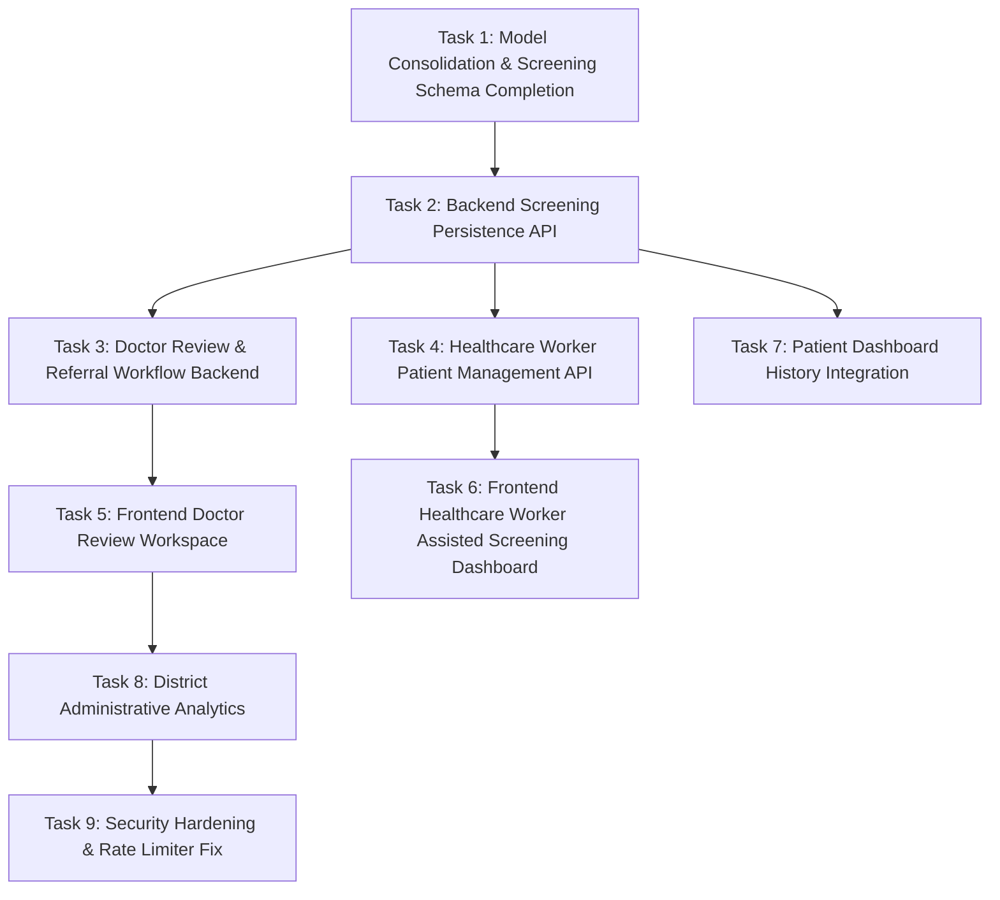

# REFACTORING ROADMAP & IMPLEMENTATION BLUEPRINT — DRISHTI (SIH26038)

## 1. Refactoring Strategy & Principles
1. **Preserve Working Foundation:** Do not touch working authentication controllers, password hashing hooks, or Admin verification logic.
2. **Strict Dependency Ordering:** Fix database schemas and persistence APIs before attempting to connect UI dashboards.
3. **No Downtime / Incremental Verification:** Every task must be verified with empirical proof (curl response, console check, or test execution).
4. **Zero TypeScript Migration:** Maintain JavaScript and CommonJS in Node backend; maintain JSX/JS in React frontend.

---

## 2. Refactoring Phases

---

### Sprint 1: Data Model Realignment & Screening Persistence (P0 — Critical)

#### Task 1: Mongoose Schema Alignment & Cleanup
- **Priority:** P0 (Critical)
- **Role:** Backend Lead
- **Action:**
  1. Remove duplicate file `Backend/models/patient.model.js`; consolidate references onto `models/patientProfile.model.js`.
  2. In `Backend/models/screening.model.js`, fix foreign key: `ref: 'Patient'` -> `ref: 'PatientProfile'`.
  3. Expand `screening.model.js` to store:
     - Optical quality metrics (`blur`, `brightness`, `contrast`, `retinaVisibility`, `isFundus`).
     - AI classification (`grade`: 0–4, `confidence`, `probabilities`, `decision`).
     - XAI links (`heatmapUrl`, `overlayUrl`, `lesionOverlayUrl`).
     - Doctor review subdocument (`reviewedBy`, `clinicalGrade`, `notes`, `triageLevel`, `referralHospital`).
- **Acceptance Criteria:** `node -e "require('./models/screening.model')"` executes with zero schema compilation errors; Mongoose model populates successfully.
- **Dependencies:** None.

#### Task 2: Backend Screening Persistence APIs
- **Priority:** P0 (Critical)
- **Role:** Backend Lead
- **Action:**
  1. Create `Backend/controller/screening.controller.js` and `Backend/routes/screening.routes.js`.
  2. Implement `POST /api/screenings/sync`: Authenticated endpoint taking the AI screening payload and saving it into MongoDB associated with `req.user._id`.
  3. Implement `GET /api/screenings/my`: Returns all screening records belonging to the authenticated patient, sorted by `createdAt: -1`.
  4. Implement `GET /api/screenings/:id`: Returns full diagnostic detail for a single screening session.
  5. Mount in `Backend/app.js`: `app.use('/api/screenings', screeningRoutes)`.
- **Acceptance Criteria:** `curl` or Postman request creates a Screening document in MongoDB; retrieving `GET /api/screenings/my` returns the saved screening object with HTTP 200.
- **Dependencies:** Task 1.

---

### Sprint 2: Clinical Review & Field Management APIs (P0 — Critical)

#### Task 3: Doctor Clinical Review & Referral Backend
- **Priority:** P0 (Critical)
- **Role:** Backend Lead
- **Action:**
  1. Create `Backend/controller/review.controller.js` and `Backend/routes/review.routes.js`.
  2. Implement `GET /api/reviews/queue`: Query screenings where `status == 'pending_review'` or `aiResult.screeningDecision.referable == true` and `status != 'reviewed'`. Protected by `authorize('doctor')`.
  3. Implement `POST /api/reviews/:screeningId`: Allows authenticated doctor to submit `clinicalGrade`, `clinicalNotes`, `triageLevel` ('routine', 'priority', 'urgent'), and `referralHospital`. Updates screening status to `'reviewed'`.
  4. Mount in `Backend/app.js`: `app.use('/api/reviews', reviewRoutes)`.
- **Acceptance Criteria:** Doctor account can fetch queue, submit a review, and verify that the screening record in MongoDB updates to status `'reviewed'`.
- **Dependencies:** Task 2.

#### Task 4: Healthcare Worker Patient Management Backend
- **Priority:** P1 (High)
- **Role:** Backend Lead
- **Action:**
  1. In `Backend/routes/patient.routes.js`, add:
     - `POST /api/patients`: Allows healthcare workers to register a field patient in outreach camps (`authorize('healthcare_worker')`).
     - `GET /api/patients`: Search patients by name, phone number, or login ID (`authorize('healthcare_worker', 'doctor')`).
- **Acceptance Criteria:** Healthcare worker registers a patient; patient receives a generated `loginId`; profile is saved in MongoDB.
- **Dependencies:** Task 1.

---

### Sprint 3: Frontend Dashboard Integration (P1 — High)

#### Task 5: Doctor Review Workspace UI
- **Priority:** P0 (Critical)
- **Role:** Frontend Lead
- **Action:**
  1. Replace static placeholder in `DoctorDashboard.tsx` with a dual-pane Clinical Review Workspace:
     - Left pane: Interactive fundus viewer with toggles for Original Image, Grad-CAM++ Attention Heatmap, and Lesion Segmentation Overlay.
     - Right pane: AI classification score, probability breakdown, clinical grade selector (0-4), doctor findings textarea, and referral dropdown.
  2. Wire data loading to `GET /api/reviews/queue` and submission to `POST /api/reviews/:screeningId`.
- **Acceptance Criteria:** Doctor logs in, clicks a case from the queue, inspects heatmaps, enters diagnosis, and completes the review with immediate status update.
- **Dependencies:** Task 3.

#### Task 6: Healthcare Worker Camp Dashboard UI
- **Priority:** P1 (High)
- **Role:** Frontend Lead
- **Action:**
  1. Replace static placeholder in `HealthcareWorkerDashboard.tsx` with:
     - "Register New Patient" modal.
     - Field patient search & quick queue.
     - "Start Assisted Screening" launcher connecting to `PatientScreeningFlow.jsx`.
- **Acceptance Criteria:** Healthcare worker registers a patient and initiates assisted screening for that patient.
- **Dependencies:** Task 4.

#### Task 7: Patient Dashboard Persistent History
- **Priority:** P1 (High)
- **Role:** Frontend Lead
- **Action:**
  1. In `PatientDashboard.jsx`, connect the `ScreeningHistory` view to `GET /api/screenings/my` instead of local component state.
  2. After AI screening completes in `PatientScreeningFlow.jsx`, dispatch `POST /api/screenings/sync` to the backend.
- **Acceptance Criteria:** After performing a screening, the patient refreshes the browser and their screening report remains accessible in the History tab.
- **Dependencies:** Task 2.

---

### Sprint 4: Security Hardening & Administrative Analytics (P2 — Medium)

#### Task 8: Security Hardening & Rate Limiter Fix
- **Priority:** P1 (High)
- **Role:** Security / Backend Lead
- **Action:**
  1. Add `express-rate-limit` to `Backend/package.json`.
  2. Mount `rateLimit.middleware.js` onto `Backend/routes/auth.routes.js` for `/login` and `/register`.
  3. Dynamic CORS binding in `Backend/app.js`: `origin: process.env.FRONTEND_URL || 'http://localhost:5173'`.
  4. Create `Backend/models/auditLog.model.js` and record administrative verification approvals/rejections.
- **Acceptance Criteria:** Rapid automated requests to `/api/auth/login` trigger HTTP 429 Too Many Requests; admin actions create audit log records in MongoDB.
- **Dependencies:** Task 1.

#### Task 9: District Administrative Analytics API
- **Priority:** P2 (Medium)
- **Role:** Backend & Frontend Leads
- **Action:**
  1. Implement `GET /api/v1/admin/analytics/districts` returning aggregated screening volumes and referable percentages by district (anonymized, no PHI).
  2. Connect Recharts bar/pie charts in `AdminDashboard.tsx` to live backend data.
- **Acceptance Criteria:** Admin dashboard renders district trends populated by real database counts.
- **Dependencies:** Task 2.
